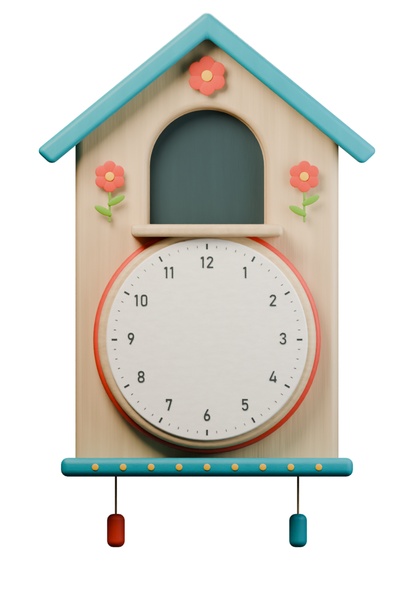

# KookieClock

[](https://github.com/Studio13-NYC/KookieClock/actions/workflows/ci.yml)

A little wooden clock with 24 visiting friends. Written in Rust, with a native Windows desktop interface, original rendered wooden-toy artwork, and offline sound.

The Windows application is currently named **Little Timber**. The repository is **KookieClock**; existing application settings and shortcuts keep working.



## Windows download

Download the Windows x64 ZIP from [Releases](https://github.com/Studio13-NYC/KookieClock/releases), extract it, and open `LittleTimber.exe`. No installer, account, browser runtime, or network connection is required. Windows 10/11 x64; the executable is unsigned.

The clock rests behind other windows. At the hour and half-hour it temporarily comes forward without stealing keyboard focus, completes its visit and final chimes, then returns behind them.

- **Ctrl+Alt+C:** bring forward. **Escape:** send behind.
- **Right-click:** Sound, Visit, Settings, and Quit.
- **Drag:** move the clock; optionally lock its position in Settings.
- **F2:** settings. **Space:** preview a shuffled visitor.
- The notification-area icon also opens the controls.

## A small cast of characters

Twelve birds visit on the hour and twelve woodland friends on the half-hour. Each cast shuffles without repeating until everyone has had a turn. Characters stay solid: doors open, the visitor enters from the left, performs, turns around, returns inside to the right, and the doors close before the time chimes.

The opening bell, wooden door contacts, foot movements, character voice, and closing chimes share one soundtrack and animation timeline. Duck, mouse, and bear use embedded generated naturalistic samples; other voices and bells are synthesized. Zen mode offers singing bowls and temple bells.

Controls include volume, sound choices, quiet hours, snooze, separate hour/half-hour switches, hour-count chimes, reduced motion, clock size, optional second hand/digital time, position locking, startup at sign-in, and a configurable hotkey.

## Platform status

| Platform | Current status |
| --- | --- |
| Windows x64 | Working native Win32/GDI+ application and portable ZIP |
| macOS Apple Silicon | Portable Rust core checked in CI; desktop interface still to be implemented |
| macOS Intel | Portable Rust core checked in CI; desktop interface still to be implemented |
| Linux | Portable Rust core checked in CI; no desktop interface |

**There is no Mac application download yet.** The scheduler, settings model, shuffled cast, choreography, and audio mixer are a shared Rust library. A Mac port needs a native window, renderer, controls, playback, and OS integration. See [the Mac port assessment](docs/macos.md).

## Build and test

On Windows, install stable Rust for `x86_64-pc-windows-msvc` and Visual Studio C++ Build Tools with a Windows SDK. From this repository:

```powershell
cargo fmt --check
cargo clippy --locked --all-targets -- -D warnings
cargo test --locked --release
cargo build --locked --release
powershell -ExecutionPolicy Bypass -File .\tools\package.ps1 -SkipBuild
```

The package is written to `dist/LittleTimber-0.1.0-windows-x64.zip`. Artwork and audio are embedded; Blender and Python are only needed to regenerate assets or run developer QA tools.

The portable core can be tested on Windows, macOS, or Linux:

```sh
cargo test --locked --release --lib
```

There are 17 automated tests covering scheduling, quiet/mute/snooze, shuffling, solid travel and door ordering, audio synchronization, bell counts, sample boundaries, and headroom. One additional ignored test exports audition WAVs. Mac core tests do **not** establish Mac UI, audio-device playback, or desktop behavior.

All repository text uses **UTF-8**, without a byte-order mark. Editor defaults are in `.editorconfig`; CI checks the encoding of tracked text files.

## Documentation and assets

- [Windows user and developer guide](docs/windows-guide.md): settings, commands, build instructions, and prior desktop verification.
- [Mac port assessment](docs/macos.md): reusable code, remaining work, and validation limits.
- [Clock behavior and sound research](docs/cuckoo-behavior-and-sound-research.md).
- [Audio provenance](assets/audio/provenance.json): generated samples and their source prompts.
- `tools/render_woodland.py` and `assets/woodland/clock-source.blend`: original artwork source.
- `src/lib.rs`: shared Rust clock and audio library; `src/main.rs`, `src/ui.rs`, and `src/draw.rs`: Windows application.

Local settings, runtime logs, recordings, build output, and unrelated projects are excluded from version control. App data stays in `%LOCALAPPDATA%\LittleTimber` on Windows.

## License

A project license has not yet been selected.
